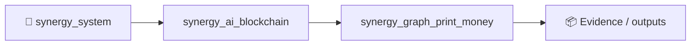
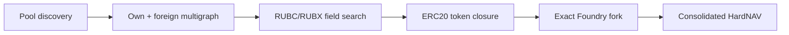

# SYNERGY Graph Print Money — Economic OS / SAG V7.4

> **PRIMARY / CANONICAL VERSION: V7.4**  
> `main` is the canonical branch. V8/V8.1/V8.2 remain research-only experiments until they beat V7.4 under the same strict token-closure and exact-fork gates.

Экспериментальная исследовательская система для построения единого мультиграфа ликвидности Base Mainnet вокруг двух протокольных денежных узлов `RUBC` и `RUBX`.

Главная идея проекта — не считать печать собственных токенов или перемещение активов между собственными LP прибылью. Единственная бухгалтерская истина — **консолидированный HardNAV** во внешних активах после возврата flash-loan, gas, MEV/competition haircut и всех обязательств.

## Канонический статус V7.4

Основная версия проекта — **V7.4**. Её текущий strongest surviving result на Base run #36:

- **6 sequential token-closed cycles**;
- **14 foreign swaps**;
- gross external hard-value transfer: **$25.0007367**;
- 35% competition/MEV reserve: **$8.7502579**;
- modelled foreign swap gas: **$0.28**;
- strict candidate `DeltaHardNAV`: **+$15.9704789**;
- reusable flash principal: **$1,556.64 WETH-equivalent + $615.29 USDC-equivalent = $2,171.93** total concurrent draw;
- token closure: **true in the strict surrogate model**;
- exact pinned-block fork: **still pending**.

Machine-readable status lives in `CURRENT_VERSION.json`.

Promotion rule:

```text
FORK_EXECUTABLE
AND every borrowed ERC20 repaid principal + actual fee in-kind
AND consolidated post-cost HardNAV > 0
```

Until that exact gate passes, V7.4 is a **TOKEN_CLOSED_SURROGATE_CANDIDATE**, not a claim of live profit.

## Текущая архитектура

- `RUBC` — эластичный monetary/settlement actuator;
- `RUBX` — второй reserve/rebalancing potential field;
- наши пулы — 50/50 CPMM `x*y=k`; при `M` внешних валютах полный собственный cross-graph содержит `C(M+2,2)` пулов;
- чужие Base pools остаются отдельными параллельными рёбрами multigraph и принадлежат чужим LP;
- стартовый собственный HardNAV исследовательской модели: **$100**;
- доступная внешняя покупательная способность: до **$50,000 Balancer V2 flash capacity**, но principal никогда не включается в NAV;
- временные `ADDLP/REMOVELP` в собственные пулы — только перераспределение нашего/заёмного инвентаря, не источник PnL;
- внешний PnL признаётся только как value transfer с внешних рынков/LP либо как настоящий seigniorage от внешнего спроса на RUBC/RUBX.

Для V6-калибровки использовалось 48 внешних активов: `50` узлов с RUBC/RUBX, `1,225` наших кросс-пулов + `240` чужих = `1,465` физических пулов.

На сохранённом Base run #36 после `address(0) -> WETH` имеется **98 canonical external assets**. С RUBC/RUBX это `100` узлов и концептуальный собственный `K_100 = C(100,2) = 4,950` пулов. Вместе с `211` foreign physical pools snapshot содержит **5,161** conceptual physical pools.

## V7: live Base Mainnet

V7 убирает синтетический foreign graph. Pipeline:

```text
Base pool discovery / pinned snapshot
        ↓
normalize token/pool addresses
        ↓
build own K_n + foreign physical multigraph
        ↓
QE/RUBC/RUBX edge-field search
        ↓
closed global-flow / cycle candidates
        ↓
exact protocol quote adapters at one block
        ↓
ERC20-by-ERC20 flash repayment gate
        ↓
Foundry/Base fork execution
        ↓
consolidated HardNAV assertion
```

Статусы кандидата: `DISCOVERED → RPC_VERIFIED → STATE_VERIFIED → QUOTE_VERIFIED → TOKEN_CLOSED → FORK_EXECUTABLE → ABUNDANCE_VERIFIED`.

**Нельзя** объявлять найденную по агрегаторным spot-данным петлю прибылью до exact same-block проверки, а production-кандидатом — до token-level repayment и `FORK_EXECUTABLE`.

## V7.3: dual-QE settlement upper bound

V7.3 оптимизировал два 98-мерных поля `RUBC` и `RUBX` поверх полного `K_100`. На 5% `q/R` CPMM-surrogate расчёт давал `+$107.7322` post-cost settlement value против `+$66.01` без QE.

V7.4 обнаружил более сильный инвариант: положительная сумма в USD **не означает**, что Balancer flash loan можно вернуть. Старый 36-leg packet имел около `$14,697.51` token-specific deficits и `$14,866.57` surpluses. Дефицит одного ERC-20 нельзя погасить surplus другого ERC-20 внутренним self-owned pool swap после консолидации.

Поэтому V7.3 `+$107.73` сохранён как **relaxed-denomination settlement upper bound**, а не как flash-executable PnL.

## V7.4: token-conservation fork layer

Главный новый инвариант:

```text
for every borrowed token A_i:
Balance_after[A_i]
>= Balance_preexisting[A_i] + Principal[A_i] + Fee[A_i]
```

Только после этого токены разрешено агрегировать в USD HardNAV.

На adapter-supported части run #36 строгий stateful CPMM-surrogate solver, мутирующий shared foreign liquidity после каждого исполнения, нашёл:

- **6 sequential token-closed cycles**;
- **14 foreign swaps**;
- gross external hard-value transfer: **$25.0007367**;
- 35% competition/MEV reserve: **$8.7502579**;
- modelled foreign swap gas: **$0.28**;
- strict candidate `DeltaHardNAV`: **+$15.9704789**;
- mathematical `$100 -> $115.9704789`;
- reusable flash principal: about **$1,556.64 WETH-equivalent + $615.29 USDC-equivalent = $2,171.93** total concurrent draw;
- largest single cycle notional: **$1,556.64**, far below the `$50k` capacity.

This result is still **surrogate / candidate**, not fork evidence. `contracts/V7_4GlobalPacketExecutor.sol` and `test/V7_4Run36Packet.t.sol` implement the exact next gate at Base block `51148993`.

## Бухгалтерские инварианты

- Flash principal: `HardNAV = hard_assets - external_liabilities`; при заимствовании $50k и наличии $100 капитала NAV остаётся $100.
- Token repayment precedes USD accounting: surplus token `B` cannot repay borrowed token `A` unless an external conversion actually executes.
- Собственный LP: `DeltaH_router + DeltaH_ownLP = 0` для self-swap, если нет внешнего контрагента.
- Own-only QE/BUY/ADDLP/REMOVELP can change graph prices and inventory location, but cannot create aggregate hard-token inventory.
- Арбитраж чужого LP: `DeltaHardNAV_SYNERGY(gross) = -Σ DeltaV_foreignLP` before external costs, subject to token-level closure.
- Аккретивная постоянная эмиссия: `DeltaH >= h_t * DeltaS`, где `h_t = H_t/S_t`.
- Abundance Surplus: `AS = DeltaH - h_t DeltaS`.

## QE: atomic vs external-absorption regime

`QE -> BUY` can create a large family of price forks in the huge `K_n` graph. But if every touched own LP and the trader belong to the protocol and everything happens in one atomic transaction, those internal moves cannot repair a hard-token deficit after consolidation.

True QE/seigniorage appears when an **external economic agent** crosses the protocol-created price displacement and deposits hard assets into protocol-owned liquidity in exchange for RUBC/RUBX. That multi-block / external-absorption regime is intentionally kept separate from V7.4 same-block flash proof.

## Balancer V2 Base

Balancer V2 Vault address used by the research executor: `0xBA12222222228d8Ba445958a75a0704d566BF2C8`. V7 checks balances/contract state at the selected block. Flash fee is not treated as a permanent zero constant: execution uses the actual `feeAmounts[]` supplied by the Vault callback, and the live quote layer can read the protocol fee at the pinned block.

For the V7.4 surrogate packet, optimized draw is about `$2,171.93`; its model break-even flash fee is roughly **73.53 bps**. Borrowing an unnecessary full `$50,000` would reduce break-even to only about **3.19 bps**, so nonzero-fee execution must size principal per token.

## Структура

- `CURRENT_VERSION.json` — canonical version/status marker;
- `docs/ECONOMIC_OS.md` — V1–V6 economic model and boundaries;
- `docs/V7_2_GLOBAL_GRAPH_ACTUATOR.md` — huge-graph QE actuator;
- `docs/V7_2_QE_CURL_MATH.md` — QE field / cycle curl math;
- `docs/V7_3_GLOBAL_ABUNDANCE_RESULTS.md` — dual 98×2 QE surrogate result;
- `docs/V7_4_TOKEN_CONSERVATION_AND_FORK.md` — strict denomination closure and fork proof plan;
- `src/synergy_graph/v7.py` — discovery/RPC/graph engine;
- `src/synergy_graph/v7_4_token_flow.py` — ERC20-level repayment accounting helpers;
- `contracts/V7ForeignCycleExecutor.sol` — single-cycle research executor;
- `contracts/V7_4GlobalPacketExecutor.sol` — **canonical multi-token/multi-cycle executor**;
- `test/V7_4Run36Packet.t.sol` — **canonical pinned Base fork gate**;
- `data/results/v7_4_packet36_token_conservation.csv` — falsification of relaxed 36-leg packet;
- `data/results/v7_4_stateful_token_closed_packet.csv` — **canonical strict 6-cycle candidate packet**;
- `.github/workflows/v7-live.yml` — broad live graph pipeline;
- `.github/workflows/v7-4-run36-fork.yml` — **primary strict fork proof workflow**.

## Experimental policy

V8/V8.1/V8.2 are preserved on research branches for ideas, accounting experiments and future improvements. They are **not** the main version and must not replace V7.4 unless they satisfy the same token-by-token closure rules and produce a strictly stronger exact-fork result.

V7.4 is **research / simulation / fork-validation code**, not an audited production trading contract. The current GitHub hosted runner is failing before the first workflow step (`steps=null`), so the six-cycle candidate has **not** yet been promoted to `FORK_EXECUTABLE`. The decisive criterion remains exact same-block execution with actual token repayment, actual flash fee and positive post-repayment consolidated HardNAV.


<!-- SYNERGY-FEDERATION-PASSPORT:START -->
---

## 🧭 SYNERGY federation passport

**Домен:** 💸 Monetary graph / Economic OS  
**Архитектурный родитель:** [`synergy_ai_blockchain`](https://github.com/Shtenco/synergy_ai_blockchain)  
**Архитектурный корень:** [`synergy_system`](https://github.com/Shtenco/synergy_system)



### Документационный контракт

README должен показывать: проблему → архитектуру → реальные артефакты → проверку → ограничения → связи с федерацией. Сильные claims без evidence остаются R&D/CANDIDATE.

### Навигация

- [📚 Атлас всех 75 репозиториев](https://github.com/Shtenco/synergy_system/blob/main/docs/SYNERGY_REPOSITORY_ATLAS.md)
- [🧾 Машиночитаемый registry](https://github.com/Shtenco/synergy_system/blob/main/registry/SYNERGY_REPOSITORIES.json)
- [🧭 SYNERGY SYSTEM](https://github.com/Shtenco/synergy_system)

### Authority rule

Репозиторий не присваивает полномочия соседнего домена: AI ≠ authorization, UI ≠ ledger, blockchain commitment ≠ accounting truth, backtest ≠ realized external P&L.

<!-- SYNERGY-FEDERATION-PASSPORT:END -->

---

# 💸 Глубокий доказательный паспорт Graph Print Money

## Что реально сильного в `main`

Этот repo уже один из наиболее зрелых monetary-falsification R&D узлов: V7.4 закреплён как current version, есть machine-readable `CURRENT_VERSION.json`, token-conservation CSV/JSON, Foundry executor и отдельные live/fork workflows.



## Ключевой отрицательный результат

V7.4 обнаружил, что положительная суммарная USD-оценка не гарантирует возврат flash loan: token-specific deficits нельзя закрыть surplus другого ERC-20 простой консолидацией.

Это важнее красивого PnL: проект уже умеет **опровергать собственные денежные конструкции**.

## Canonical gate

```text
FORK_EXECUTABLE
+ every borrowed ERC20 repaid principal + actual fee in-kind
+ post-cost consolidated HardNAV > 0
```

До выполнения всех трёх условий результат остаётся candidate, даже если surrogate DeltaHardNAV положителен.

## Следующий рубеж

exact pinned-block run #36 → all-token repayment → actual gas/fees → repeat across independent historical blocks → adversarial MEV/competition → Financial OS accounting handoff.
